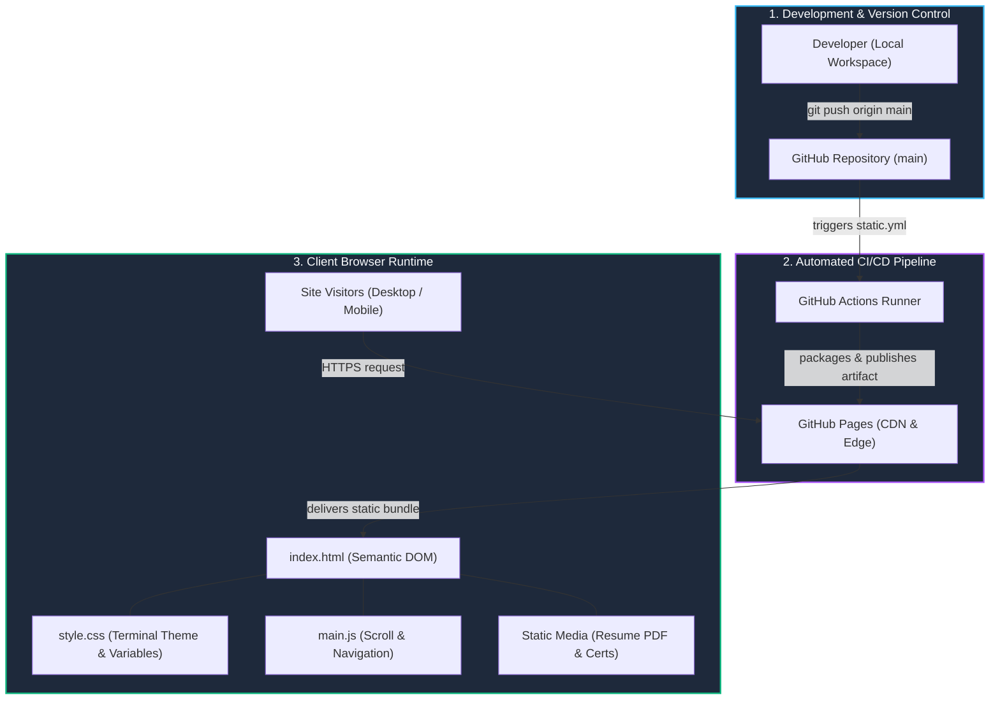

# Shoaib Khan's Portfolio

A personal portfolio built with a modern, terminal-inspired aesthetic. This project showcases my skills, experience, and projects as an aspiring Software Development Engineer.

## Live Demo
🚀 **[View the live portfolio here](https://shoaibkhan-sde.github.io/my-portfolio/)**

## Technologies Used
- HTML5 for semantic structure
- Vanilla CSS with CSS Variables for theme and styling
- Vanilla JavaScript for scroll animations (`IntersectionObserver`) and mobile navigation

## Running Locally
This project uses plain HTML/CSS/JS and doesn't require a complex build step. You can run it locally with any simple HTTP server:

### Option 1: Python HTTP Server (Recommended)
```bash
# In the project directory, run:
python -m http.server 8080
```
Then visit `http://localhost:8080` in your browser.

### Option 2: Node.js Serve
```bash
# In the project directory, run:
npx serve .
```

### Option 3: Direct File
Alternatively, you can just open the `index.html` file directly in your web browser.

## Deployment
This portfolio is automatically deployed to **GitHub Pages** using **GitHub Actions**. Any changes pushed to the `main` branch trigger a deployment workflow (defined in `.github/workflows/static.yml`) which publishes the static assets directly to the live site.

## System Architecture



🔍 **[Explore the Interactive Architecture Diagram](https://shoaibkhan-sde.github.io/my-portfolio/portfolio-architecture.html)** *(Full-screen pan/zoom, guided views, and presentation mode)*

### Architecture Breakdown
- **CI/CD Automation:** Every commit pushed to the `main` branch triggers a lightweight GitHub Actions workflow (`.github/workflows/static.yml`), packaging and uploading static web assets to GitHub Pages.
- **Global Edge Delivery:** GitHub Pages distributes the portfolio globally over HTTPS with edge caching for minimal latency and high availability.
- **Client Presentation:** Built with pure vanilla web standards (HTML5 semantic layout, CSS custom properties for terminal styling, and vanilla JavaScript for `IntersectionObserver` animations), eliminating external framework overhead.

## Features
- **Responsive Design:** Automatically adapts to mobile screens with a collapsible sidebar menu.
- **Scroll Animations:** Sections slide into view smoothly as the user scrolls down the page.
- **Terminal Theme:** Features a unique design with code-editor-style sidebars, file tabs, and a blinking cursor hero section.

